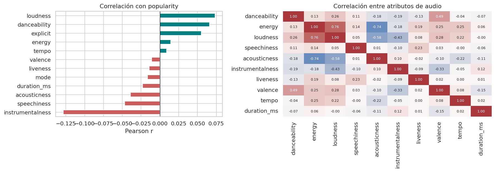
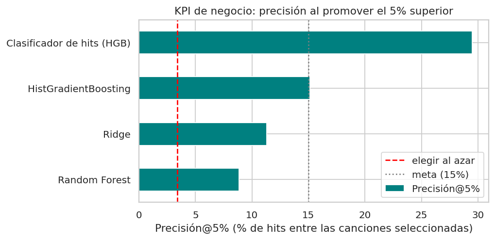
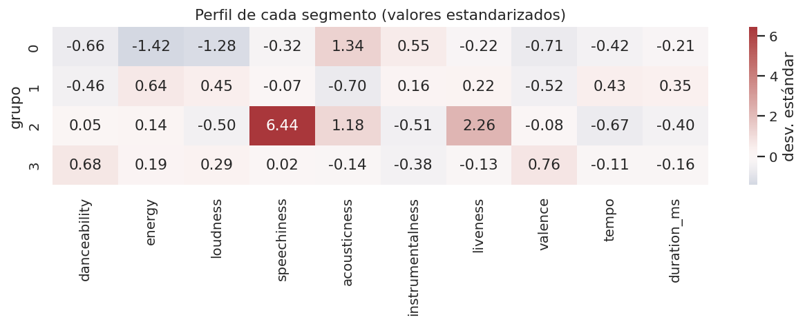

# 🎵 Inteligencia Musical y Predicción de Popularidad en Spotify

**Curso:** Machine Learning (MLY1101) · **Evaluación Parcial N°2** · **Caso C – Spotify Tracks**
**Grupo 5:** Diego Marambio · Sebastián Álvarez · Álvaro Sepúlveda · Erick Rosales

> Informe técnico reproducible. El desarrollo completo (código, explicaciones e interpretaciones) está en [`notebooks/Informe_Tecnico.ipynb`](notebooks/Informe_Tecnico.ipynb); este README resume el proyecto.

---

## 1. Descripción del problema de negocio

Los sellos discográficos y equipos de **A&R** deben decidir en qué canciones invertir su presupuesto de promoción entre miles de lanzamientos, hoy con criterios subjetivos.

> **¿Pueden las características de una canción (audio, género y metadatos) ayudar a priorizar qué temas promocionar, es decir, anticipar cuáles tienen más probabilidad de ser populares en Spotify?**

## 2. Objetivos del proyecto

**General.** Aplicar el ciclo completo de CRISP-DM al *Spotify Tracks Dataset* para cuantificar en qué medida las características de una canción explican su popularidad, comparar modelos supervisados y no supervisados, y traducir los resultados en recomendaciones honestas para A&R.

**Específicos.**
1. Limpiar y consolidar el dataset a nivel de canción única, sin fuga de datos.
2. Cuantificar la relación entre atributos de audio/género y la popularidad.
3. Comparar al menos dos modelos supervisados frente a un *baseline*.
4. Descubrir segmentos de canciones con una técnica no supervisada.
5. Entregar recomendaciones, límites y riesgos para el negocio.

## 3. Definición de KPIs

*Hit* = canción con `popularity ≥ 70`.

| Tipo | KPI | Meta | Resultado | Estado |
|---|---|---|---|---|
| Técnico | MAE (test) | ≤ 12 puntos | **11,08** | ✅ |
| Técnico | Mejora de MAE vs. baseline | ≥ 25% | **35,1%** | ✅ |
| Técnico | R² (test) | ≥ 0,30 | **0,412** | ✅ |
| Negocio | Precisión@5% (regresor HGB) | ≥ 15% | **15,1%** (azar: 3,4%) | ✅ (margen estrecho) |
| Negocio | Lift vs. azar | ≥ 3× | **4,5×** | ✅ |
| Negocio | Precisión@5% (clasificador de hits) | ≥ 15% | **29,5%** (lift 8,7×; recall 43%) | ✅ |

*Precisión@5%: proporción de hits reales entre el 5% de canciones mejor puntuadas por el modelo.* La meta original del EP1 (precisión ≥ 40%) **no se alcanza** y las metas técnicas del EP1 (R² ≥ 0,85; MAE < 5,5) se descartaron por inalcanzables (ver sección 7).

## 4. Fuentes de datos

- **Archivo:** `data/Spotify_Tracks_Dataset.csv` — 114.000 filas × 21 columnas con atributos de audio equivalentes a los de la API Web de Spotify, metadatos y género.
- **Variable objetivo:** `popularity` (0–100), índice **propietario de Spotify**.
- **Origen:** conjunto público de Kaggle. ⚠️ *Completar: enlace de descarga y fecha de acceso.*
- **Herramientas:** Python (pandas, scikit-learn, matplotlib, seaborn), Jupyter/Colab y GitHub. ⚠️ *Completar: enlace al repositorio.*

## 5. Preparación y análisis exploratorio (EDA)

**Preparación (114.000 → 89.583 canciones únicas):**

| Etapa | Filas |
|---|---|
| Dataset original | 114.000 |
| Sin duplicados exactos (−450) | 113.550 |
| Sin filas con nulos (−1) | 113.549 |
| Sin `tempo = 0` (−157) | 113.392 |
| **Canciones únicas por `track_id`** (−23.809) | **89.583** |

- `time_signature` 0 o 1 (1.130 filas) se imputa a 4/4.
- Una canción aparece en varios géneros → se consolida una fila por canción y el **género se codifica *multi-hot***.
- Otro 9,5% son versiones con distinto `track_id` → la partición *train/test* es **por grupos** (artista + nombre): 0 canciones compartidas entre entrenamiento y prueba (una partición aleatoria simple dejaría 13,2% de fuga).

**Hallazgos del EDA**

| Hallazgo | Evidencia |
|---|---|
| Los hits son raros | Solo **3,48%** de las canciones tienen popularidad ≥ 70 |
| El audio, por sí solo, no explica la popularidad | Ninguna variable supera \|r\| = 0,13 (la mayor: `instrumentalness`, −0,129) |
| Los ceros de popularidad son sospechosos | 10,4% de las canciones; 7 géneros tienen > 50% de ceros (jazz 68%, rock 53%…) |
| El contenido explícito se asocia a más hits | 7,3% vs. 3,1% (probablemente un efecto del género, no causal) |
| El ranking de artistas necesita un mínimo | Sin filtro lidera un artista con 1 canción; con ≥ 10 canciones califica solo el 9% de los artistas |



## 6. Metodología (CRISP-DM)

| Fase | Qué se hizo | Sección del notebook |
|---|---|---|
| 1. Comprensión del negocio | Problema, objetivos SMART, KPIs técnicos y de negocio | 1 y 2 |
| 2. Comprensión de los datos | Diagnóstico de calidad y EDA narrativo | 3 y 5 |
| 3. Preparación de los datos | Limpieza, consolidación por canción, *multi-hot*, partición por grupos, `Pipeline` | 4 y 7 |
| 4. Modelado | 3 regresores + *baseline* + clasificador de hits (supervisado) y K-Means (no supervisado) | 8 y 9 |
| 5. Evaluación | KPIs, ablación, sensibilidad a ceros, equidad por género | 10 |
| 6. Despliegue | Modelo guardado (`models/`) y recomendaciones | 11 |
| Transversal | Sesgos, ética y privacidad | 6 |

## 7. Resultados

### Modelos supervisados (regresión de `popularity`, conjunto de prueba)

| Modelo | R² | MAE | RMSE | Mejora MAE vs. baseline |
|---|---|---|---|---|
| Baseline (media) | 0,00 | 17,09 | 20,46 | — |
| Ridge | 0,365 | 11,72 | 16,31 | 31,4% |
| Random Forest | 0,260 | 13,89 | 17,61 | 18,7% |
| **HistGradientBoosting** | **0,412** | **11,08** | **15,69** | **35,1%** |

Hiperparámetros elegidos por validación cruzada agrupada (`GroupKFold`, 3 pliegues) solo con datos de entrenamiento. HGB es el mejor en todas las métricas (MAE y R² en prueba, validación cruzada y Precisión@5%); Ridge es la alternativa interpretable.

**Qué explica la popularidad (ablación con HGB):**

| Variables usadas | R² test | MAE test |
|---|---|---|
| Solo audio + metadatos musicales | 0,108 | 15,36 |
| Solo género | 0,394 | 11,13 |
| Audio + género | 0,412 | 11,08 |

El género domina; el audio agrega muy poco. Esto no implica causalidad: en este dataset el género está mezclado con los sesgos de la fuente.

### KPIs de negocio (promover el 5% mejor puntuado)

| Estrategia | Precisión@5% | Lift | Recall@5% |
|---|---|---|---|
| Elegir al azar | 4,2% | 1,2× | 6,1% |
| Random Forest | 8,9% | 2,6× | 13,0% |
| Ridge | 11,3% | 3,3× | 16,6% |
| HGB (regresión) | 15,1% | 4,5× | 22,2% |
| **Clasificador de hits (HGB)** | **29,5%** | **8,7×** | **43,3%** |



### Modelo no supervisado (K-Means, k = 4, sobre variables de audio)

Estabilidad entre semillas ARI = 0,83; silueta = 0,158 (estructura débil: los perfiles tienen bordes difusos).

| Segmento | Perfil | Canciones | Tasa de hits |
|---|---|---|---|
| 0. Acústico / ambiental | energy 0,27; acousticness 0,78 | 21% | 1,7% |
| 1. Intenso (rock / metal) | energy 0,80; loudness −6,2 dB | 34% | 2,7% |
| 2. Hablado / comedia | speechiness 0,82 | 1% | 0,5% |
| 3. Bailable y positivo | danceability 0,68; valence 0,67 | 44% | **5,0%** |

Los segmentos explican < 1% de la varianza de la popularidad (η² = 0,008): sirven para *benchmarking* y organización del catálogo, no para predecir éxito.



## 8. Interpretación y recomendaciones para el negocio

1. **Usar el modelo como filtro de priorización, no como decisor.** El 5% mejor puntuado por el clasificador contiene ~29% de hits (vs. ~3% al azar), pero ~7 de cada 10 canciones promovidas no serán hits.
2. **No leer la popularidad predicha como valor esperado:** el regresor comprime hacia la media y subestima los hits en ~34 puntos.
3. **No invertir en "sonar como un hit":** el audio explica poco. Mejorar la predicción requiere variables hoy ausentes (audiencia del artista, promoción, *playlists*).
4. **Comparar canciones dentro del mismo género o segmento**, porque el puntaje no es comparable entre géneros.
5. **Validar `popularity` con datos propios** de la empresa y aclarar qué significa un 0 antes de pasar a producción.

## 9. Sesgos, ética y privacidad

- **Sesgo de la fuente (el principal):** `popularity` es una métrica propietaria de Spotify que refleja lo que la plataforma promueve; el modelo aprende a reproducir esas decisiones, no a medir calidad musical.
- **Sesgo de selección:** los 114 géneros tienen exactamente 1.000 canciones; no es una muestra representativa del mercado.
- **Datos faltantes:** los ceros se concentran en ciertos géneros y probablemente son en parte un artefacto de la fuente.
- **Sesgo de popularidad previa:** favorece lo que ya funciona sobre el talento emergente.
- **Ética:** el modelo es apoyo a la decisión; no debe usarse para descartar artistas o géneros, y se recomienda reservar cupos de promoción fuera del *top* para evitar la homogeneización.
- **Privacidad:** los nombres de artistas son datos personales de personas reales; el modelo **no los usa** como variable. Marco de referencia: Ley 19.628 y Ley 21.719 (Chile) y GDPR; el uso comercial debe respetar los términos de la API de Spotify.

## 10. Limitaciones

Variable objetivo propietaria y circular · dataset sin fecha de extracción · ceros sin verificar · sin variables de artista/promoción · hiperparámetros en el borde de la grilla · sin intervalos de confianza · segmentos con silueta baja.

## 11. Estructura del proyecto y cómo reproducirlo

```
EVA02/
├── data/
│   └── Spotify_Tracks_Dataset.csv
├── notebooks/
│   └── Informe_Tecnico.ipynb      ← informe técnico completo y ejecutable
├── images/                        ← gráficos generados por el notebook
├── models/
│   ├── modelo_popularidad.joblib
│   └── modelo_popularidad_metricas.json
├── requirements.txt
└── README.md
```

```bash
pip install -r requirements.txt
jupyter notebook notebooks/Informe_Tecnico.ipynb     # Kernel → Restart & Run All
```

El notebook completo se ejecuta en menos de 10 minutos (semilla fija `random_state=42`). En Google Colab: subir el CSV a `data/` (o clonar el repositorio) y usar *Entorno de ejecución → Reiniciar y ejecutar todo*.

**Cargar el modelo entrenado:**
```python
import joblib
modelo = joblib.load("models/modelo_popularidad.joblib")
# modelo.predict(X)  # X con las mismas columnas que se usaron al entrenar (ver el notebook, sección 7)
```
